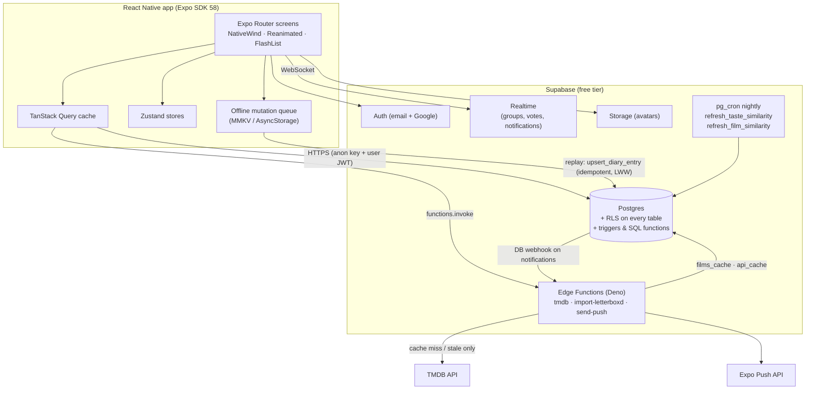
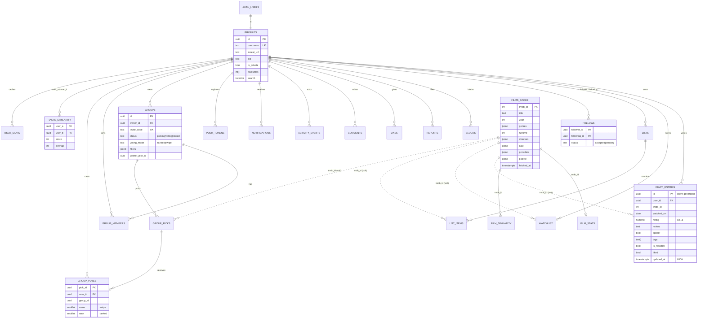

# Reelo — architecture

## System

Key flows (blueprint section 4):

1. **Browse/search** → `tmdb` edge function → `films_cache`/`api_cache` hit, else TMDB → cache → app. The TMDB key
   exists only as an edge-function secret.
2. **Log a film** → offline queue (client UUID) → `upsert_diary_entry` RPC → triggers refresh `film_stats` and write an
   `activity_events` row. Offline: queued in MMKV, replayed in order on reconnect.
3. **Feed** → `get_feed(cursor, limit)` joins `activity_events` with accepted follows; cursor on `(created_at, id)`.
4. **Voting** → clients subscribe to `group_votes` via Realtime; tallies recompute live; `close_voting` decides.
5. **Recommendations** → pg_cron refreshes `taste_similarity` and `film_similarity`; the app blends them with
   content features and popularity.

## Entity–relationship diagram

`tmdb_id` references to `films_cache` are deliberately *soft* (no FK): a film can be logged before it has ever been
cached, and the cache can be refreshed or evicted independently.

## RLS summary (blueprint 5.4)

| Table | Read | Write |
| --- | --- | --- |
| profiles | any signed-in user | owner only (insert via auth trigger) |
| diary_entries, watchlist, activity_events, user_stats | owner, or anyone if profile public, or accepted followers; never when blocked | owner only |
| lists / list_items | public lists: everyone; private: owner | owner only |
| follows | signed-in users | create/delete own; followed user may accept or remove |
| likes, comments | if the target is visible to you | create/delete own (comments rate-limited) |
| groups, members, picks, votes | members only | picks while `picking`; votes own-only while `voting`; status via RPC |
| notifications, push_tokens, blocks, reports | owner only | owner only (notifications written by triggers) |
| films_cache, film_stats, film_similarity | signed-in users | service role / triggers only |
| api_cache | nobody | service role only |
| taste_similarity | the two users in the pair | nightly job only |

Checked automatically by `npm run test:db` (PGlite) — see `scripts/test-db.mjs`.
